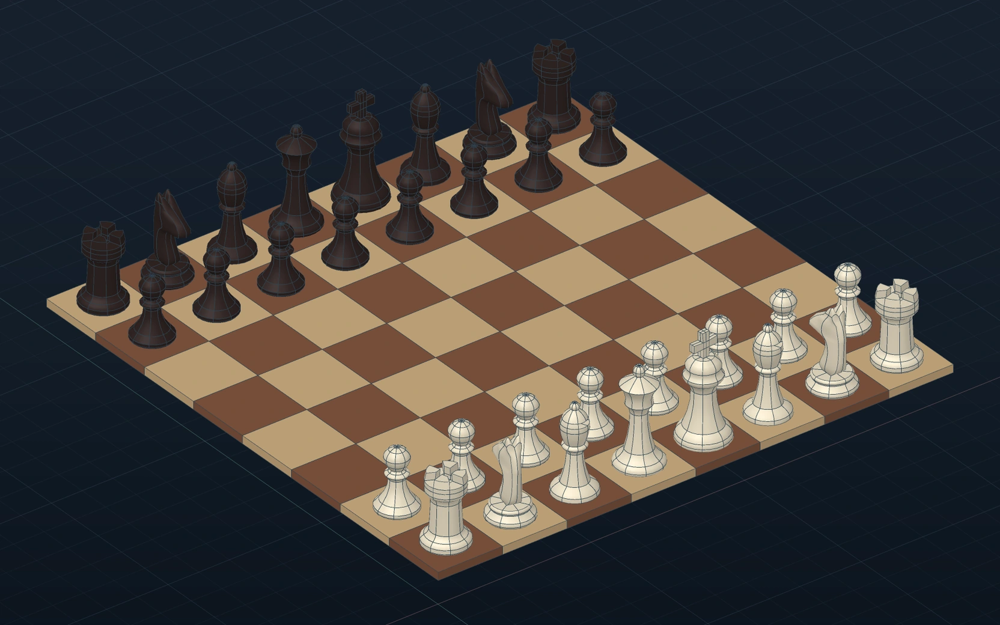
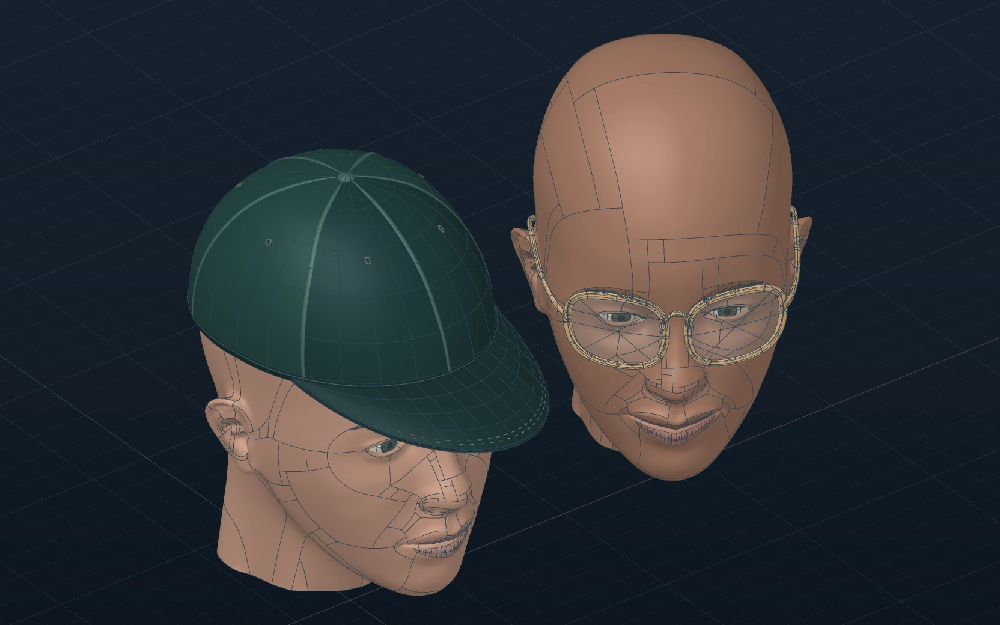

# ForCAD

[](https://github.com/gha3mi/forcad/releases/latest)
[](https://github.com/gha3mi/forcad/actions/workflows/CI-CD.yml)
[](https://gha3mi.github.io/forcad/)
[](LICENSE)
[](https://zenodo.org/doi/10.5281/zenodo.10904447)

ForCAD is a Fortran library for NURBS curves, surfaces, and volumes. Build geometry in code or edit it in **ForCAD Studio**, then use the same model for structured meshing and isogeometric analysis (IGA).

[Start ForCAD Studio](#start-forcad-studio) · [Use the Fortran API](#use-the-fortran-api) · [Browse examples](docs/guide/reference/examples.md) · [Read the handbook](https://gha3mi.github.io/forcad/)

[](docs/images/studio-chess.webp)
[](docs/images/studio-head.webp)

*Chess and Head, two editable projects included with ForCAD Studio.*

## Features

- **Geometry construction.** Start from primitives or define Bézier, B-spline, and NURBS patches, including periodic curves. Extrude, revolve, sweep, loft, and transform them.
- **Patch editing.** Edit controls and weights, insert or remove knots, and elevate or reduce degree. Refine or split patches and extract parameter ranges, faces, and sections.
- **Multipatch assemblies.** Connect patches, check interface orientation and continuity, and edit shared controls across a join.
- **Structured meshing.** Generate line, quadrilateral, or hexahedral cells by count or target size, with conforming hex meshes across matching volume faces.
- **Fitting and measurement.** Fit patches to point data by least squares, find closest points and their parameters, and measure length, area, or volume.
- **Sensitivity and IGA.** Differentiate geometric measures with respect to control positions and weights. Assemble IGA systems with spline basis functions, physical derivatives, quadrature, and shared degrees of freedom.
- **Interactive modeling.** Explore parameter domains, basis plots, and mesh cells. Undo or redo edits and review changes proposed by the optional [AI Assistant](docs/guide/assistant/index.md).
- **File exchange.** Save FCAD projects, import and export IGES curves and surfaces, write VTK grids, and export a model as a standalone Fortran program.

## Quick start

### Start ForCAD Studio

Install Git and [Pixi](https://pixi.sh/), then run the commands below. The first launch builds Studio. [Platform prerequisites](docs/guide/how-to/install.md)

```sh
git clone --branch dev https://github.com/gha3mi/forcad.git
cd forcad
pixi run start
```

From the home screen, open **Chess** to [inspect a multipatch model](docs/guide/tutorials/explore-studio.md).

### Use the Fortran API

Add ForCAD to your fpm project's `fpm.toml`.

```toml
[dependencies]
forcad = { git = "https://github.com/gha3mi/forcad.git", branch = "dev" }
```

Save this program as `app/main.f90` and run `fpm run`. A tube with radii 1 and 2 and length 4 has a volume of 12π cubic units. The program prints `37.6991`.

```fortran
program measure_tube
    use forcad, only: nurbs_volume, rk
    implicit none
    type(nurbs_volume) :: tube
    real(rk) :: volume

    call tube%set_ring(center=[0._rk, 0._rk, 0._rk], &
                       radius1=1._rk, radius2=2._rk, length=4._rk)
    if (.not. tube%err%ok) error stop "Could not construct the tube"
    call tube%cmp_volume(volume, ngauss=[10, 2, 2])
    if (.not. tube%err%ok) error stop "Could not measure the tube"
    print '(f8.4)', volume
end program measure_tube
```

### Try isogeometric analysis

The [IGA guides](docs/guide/iga/index.md) start with a one-dimensional Poisson problem and extend to [two volumes with a shared face](docs/guide/iga/solve-two-volumes-poisson.md), where you can check both the solution and the flux across the interface.

## Dependencies

Pixi manages the build tools. fpm resolves the [core](fpm.toml) and [Studio](fpm-studio.toml) dependencies.

| Component | Dependencies |
| --- | --- |
| Core library | Fortran compiler, [OpenMP](https://www.openmp.org/), [forIGES](https://github.com/rweed/forIGES) for IGES exchange, [fordebug](https://github.com/gha3mi/fordebug) for diagnostics |
| ForCAD Studio | [Qt 6](https://www.qt.io/), [qt-fortran](https://github.com/jacobwilliams/qt-fortran), a C++ compiler, pkg-config, and Python for the Qt build helper |
| Optional AI Assistant | Codex CLI, OpenCode CLI, Claude Code CLI, or Ollama. See [agent roles and skills](docs/guide/assistant/roles-and-skills.md). |
| Tests and examples | [forunittest](https://github.com/gha3mi/forunittest) with [FACE](https://github.com/szaghi/FACE) for test output. Examples use [forimage](https://github.com/gha3mi/forimage), [forcolormap](https://github.com/vmagnin/forcolormap), and [fortime](https://github.com/gha3mi/fortime). fordebug also uses fortime. |
| Documentation and lint | [FORD](https://forddocs.readthedocs.io/), [Pagefind](https://pagefind.app/), and [Fortitude](https://fortitude.readthedocs.io/) |

From the checkout, `pixi run -e gnu test` runs the core tests and `pixi run docs` builds the handbook. [Compiler environments](docs/guide/reference/build.md) · [Contributing](CONTRIBUTING.md) · [Report an issue](https://github.com/gha3mi/forcad/issues)

Copyright © 2026 Seyed Ali Ghasemi. [BSD 3-Clause License](LICENSE)
